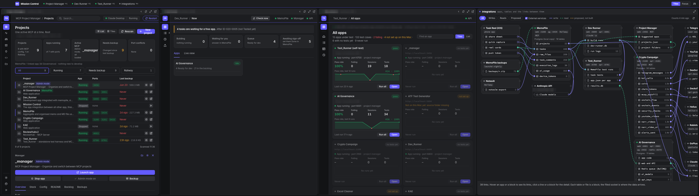
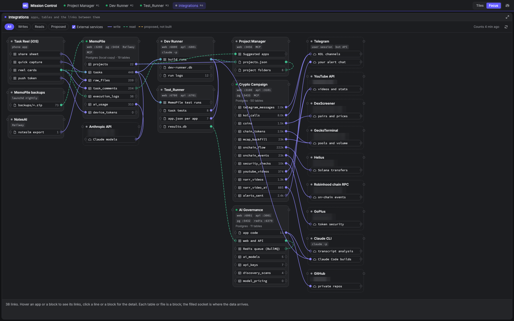
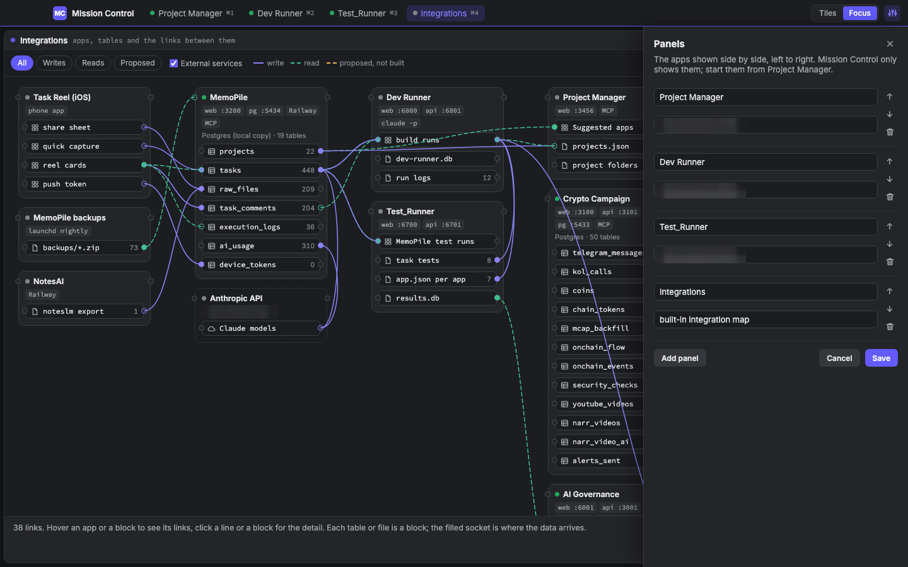

# Mission Control

One window that shows several apps side by side, sized for a 32:9 ultrawide, with a built-in map of which app moves data to which. It is only a viewer: it never starts, stops or changes the apps.

> **Source code is private.** This repository shows what Mission Control does and how it is built. The code is available on request.

## Why

When AI agents build and test across several apps at once, the useful view is all of them together: the task pile, the builder, the tester and the apps themselves, without juggling tabs. And with apps talking to each other through their own APIs and MCP servers, it helps to see exactly where the data goes.

## Screens

- **Tiles** puts the panels side by side. Drag a divider to change widths; double-click it to make them equal again.
- **Focus** shows one panel full size, with the panels as tabs in the top bar. ⌘1 to ⌘9 picks a panel, ⌘0 goes back to Tiles.
- Every panel has a status dot, Back, Reload, Focus and Open in the browser. Mission Control checks every 20 seconds that each app answers, and says so plainly when one is not running.
- **Integrations** is a built-in map: one box per app or outside service, each table or file a block inside it, and a line from where the data comes from to where it lands, with writes and reads drawn differently.
- **Panels** sets which apps are shown, and in what order.

## Screenshots

Real screens, taken headless from the real renderer; names and addresses are blurred.

| | |
|---|---|
|  |  |
| **Integrations**: which app moves data to which | **Panels**: choose and order the apps shown |

## How it is built

| Part | Technology |
|---|---|
| App | Electron, one window with a panel per app |
| Sessions | One shared session, so logins and app settings survive restarts |
| Map | A description of every app, its tables and files and every link between them, written by reading each app's code, plus live read-only counts |
| Runs on | A Mac, from a small launcher |

No app is the master: the apps are peers, and apart from checking that each one answers and the map's read-only counts, Mission Control reads nothing from them.

## Part of a pipeline

- [**MemoPile**](https://github.com/man-pi/memopile-showcase): the AI task pile that feeds the pipeline
- [**Dev Runner**](https://github.com/man-pi/dev-runner-showcase): builds tasks with Claude Code and writes their tests
- [**Test_Runner**](https://github.com/man-pi/test-runner-showcase): runs Playwright, Cypress, Jest and k6, and reports back
- [**Project Manager**](https://github.com/man-pi/project-manager-showcase): knows every app and starts it

## Licence

Copyright (c) 2026 man-pi. All rights reserved. The screenshots and text in this repository may not be reused without permission.
